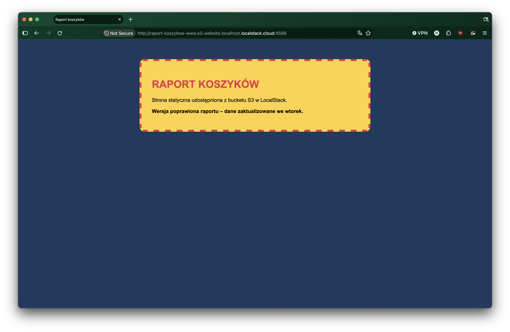
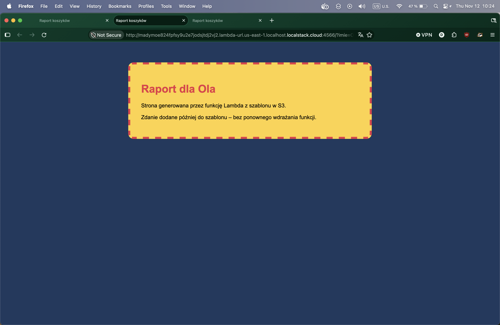
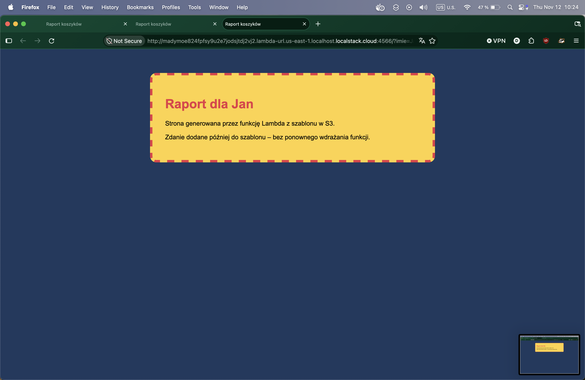

# Lab 2 – Jedna strona, dwa sposoby udostępnienia

Autor: Bartosz Dainowski
Środowisko: macOS (Apple M4), Docker Desktop, LocalStack w Docker Compose, CLI `lstk`.

## Nazwy zasobów

| Zasób | Nazwa |
|---|---|
| Bucket strony statycznej (S3 Website) | `raport-koszykow-www` |
| Bucket szablonu (prywatny, ustawienia domyślne) | `raport-koszykow-szablony` |
| Obiekt szablonu | `s3://raport-koszykow-szablony/template.html` |
| Funkcja Lambda | `raport-koszykow-lambda` (Python 3.12, handler `lambda_function.handler`) |

Adresy:
- S3 Website: http://raport-koszykow-www.s3-website.localhost.localstack.cloud:4566/
- Lambda Function URL: http://madymoe824fpfsy9u2e7jodsjtdj2vj2.lambda-url.us-east-1.localhost.localstack.cloud:4566/

## Pliki w repozytorium

- `compose.yaml`: LocalStack, port tylko `127.0.0.1:4566`, gniazdo `/var/run/docker.sock` podmontowane, żeby LocalStack mógł uruchamiać Lambdy w kontenerach Dockera; token w `.env` (plik w `.gitignore`)
- `www/index.html`, `www/style.css`: strona statyczna
- `policy.json`: polityka bucketu, publiczny odczyt (`s3:GetObject`) tylko dla `raport-koszykow-www`
- `template.html`: końcowa wersja szablonu (CSS wbudowany, nagłówek `Raport dla {{IMIE}}`)
- `lambda/lambda_function.py`: kod funkcji
- `deploy.sh`: wszystkie polecenia wdrożenia
- `dowody/polecenia-lstk.txt`: pełny wynik wdrożenia z konsoli
- `dowody/odpowiedzi-http.txt`: pełne odpowiedzi HTTP i odczyt szablonu z S3

## Uruchomienie środowiska

```bash
# .env (nie trafia do repo): LOCALSTACK_AUTH_TOKEN=...
docker compose up -d
lstk status
```

## Wdrożenie wariantu 1: S3 Website

```bash
lstk aws s3 mb s3://raport-koszykow-www
lstk aws s3 cp www/index.html s3://raport-koszykow-www/index.html --content-type "text/html; charset=utf-8"
lstk aws s3 cp www/style.css  s3://raport-koszykow-www/style.css  --content-type "text/css"
lstk aws s3 website s3://raport-koszykow-www --index-document index.html
lstk aws s3api put-bucket-policy --bucket raport-koszykow-www --policy file://policy.json
```

Zmiana zdania po publikacji: „Wersja pierwsza raportu – dane z poniedziałku.” → „Wersja poprawiona raportu – dane zaktualizowane we wtorek.”

```bash
lstk aws s3 cp www/index.html s3://raport-koszykow-www/index.html --content-type "text/html; charset=utf-8"
```



## Wdrożenie wariantu 2: Lambda Function URL

```bash
lstk aws s3 mb s3://raport-koszykow-szablony
lstk aws s3 cp template.html s3://raport-koszykow-szablony/template.html --content-type "text/html; charset=utf-8"
cd lambda && zip ../funkcja.zip lambda_function.py && cd ..
lstk aws lambda create-function --function-name raport-koszykow-lambda \
  --runtime python3.12 --handler lambda_function.handler \
  --zip-file fileb://funkcja.zip \
  --role arn:aws:iam::000000000000:role/lambda-role \
  --environment "Variables={TEMPLATE_BUCKET=raport-koszykow-szablony,TEMPLATE_KEY=template.html}"
lstk aws lambda create-function-url-config --function-name raport-koszykow-lambda --auth-type NONE
```

Paczka `funkcja.zip` zawiera tylko `lambda_function.py`. Szablon zostaje w S3. Bucket szablonu nie ma polityki ani hostingu (`get-bucket-policy` → `NoSuchBucketPolicy`).

Później dodałem do szablonu zdanie „Zdanie dodane później do szablonu – bez ponownego wdrażania funkcji.” i podmieniłem obiekt **`s3://raport-koszykow-szablony/template.html`**:

```bash
lstk aws s3 cp template.html s3://raport-koszykow-szablony/template.html --content-type "text/html; charset=utf-8"
```

Funkcji nie wdrażałem ponownie. Po odświeżeniu strony nowe zdanie jest widoczne.





## Odpowiedzi HTTP i źródło HTML

Status 200 i Content-Type:
```
$ curl -si ".../?imie=Ola"
HTTP/1.1 200 OK
Content-Type: text/html; charset=utf-8
    <h1>Raport dla Ola</h1>
    <p>Zdanie dodane później do szablonu – bez ponownego wdrażania funkcji.</p>
```

Status 400 (brak parametru lub pusta wartość):
```
$ curl -si ".../"
HTTP/1.1 400 BAD REQUEST
Content-Type: text/plain; charset=utf-8

Brak parametru imie. Użyj np. ?imie=Ola
```

Znaki specjalne wyświetlają się jako tekst (`html.escape`):
```
$ curl -s ".../?imie=%3Cscript%3Ealert(1)%3C%2Fscript%3E"
    <h1>Raport dla &lt;script&gt;alert(1)&lt;/script&gt;</h1>
```

Obiekt odczytany z S3 po podmianie nadal zawiera znacznik:
```
$ lstk aws s3 cp s3://raport-koszykow-szablony/template.html -
    <h1>Raport dla {{IMIE}}</h1>
    <p>Strona generowana przez funkcję Lambda z szablonu w S3.</p>
    <p>Zdanie dodane później do szablonu – bez ponownego wdrażania funkcji.</p>
```

## Wniosek

W wariancie S3 Website HTML dostarcza sam S3. Serwuje gotowe pliki dokładnie w takiej postaci, w jakiej zostały przesłane, i nie wykonuje przy tym żadnego kodu. W wariancie Lambda HTML tworzy funkcja przy każdym żądaniu: pobiera szablon z S3, wstawia imię i zwraca odpowiedź przez Function URL.

Strona statyczna wystarcza, gdy treść jest taka sama dla każdego odbiorcy (opis, raport, dokumentacja). Jest prostsza, tańsza i nie wymaga kodu.

Szablon trzymamy osobno od kodu, bo wygląd i treść strony zmieniają się częściej niż logika. Wystarczy wtedy przesłać nowy `template.html` do S3, bez budowania paczki i ponownego wdrażania funkcji, co pokazało dodane zdanie. Oddzielamy też odpowiedzialności: szablon może zmieniać ktoś, kto nie ma uprawnień do wdrażania kodu. Obiekt w S3 zawsze zawiera `{{IMIE}}`, a podstawienie dzieje się dopiero w odpowiedzi funkcji.
